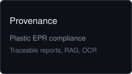
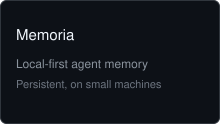

I enjoy exploring the evolving field of AI and building intelligent applications that solve real-world problems.

Currently focused on **Agentic AI, LLMs, Multi-Agent Systems, RAG, and Applied Machine Learning**.

 

selected work

 

 

stack

 

 

